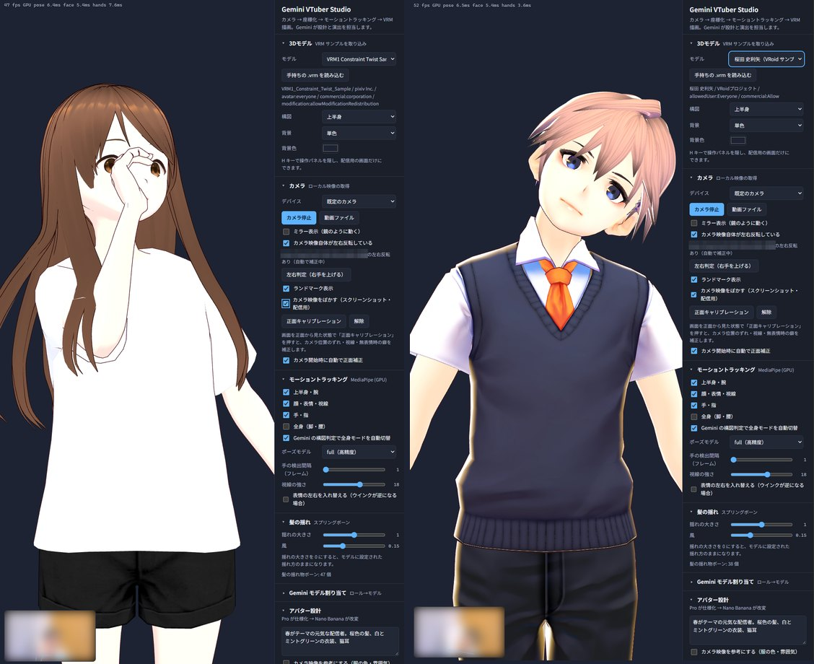
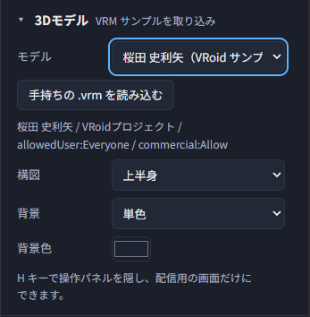
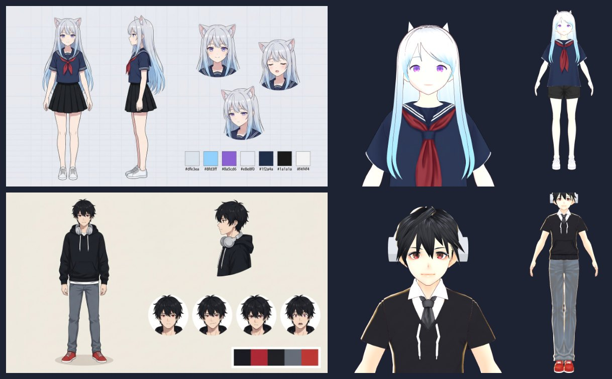
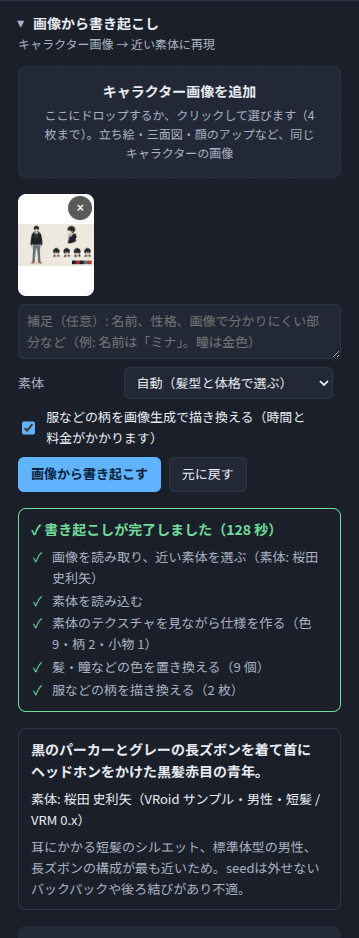
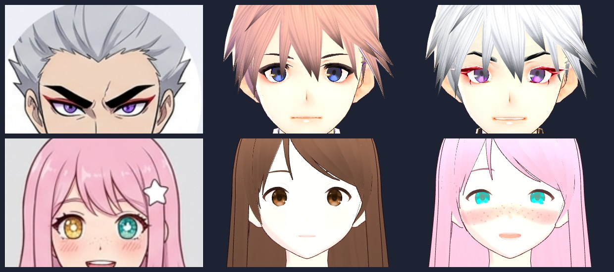

# Gemini VTuber Studio

ローカルカメラの映像から、VRM アバターをリアルタイムに動かす VTuber アプリです。
カメラ取得 → 座標化 → モーショントラッキング → 3D 描画はブラウザ内で毎フレーム処理します。
Gemini の各モデルは、演出・空間認識・外見の設計・画像生成・音声を役割ごとに分担します。

- 3D モデル: VRM コンソーシアムの汎用サンプル（VRoid 標準構造）を取り込み、その構造のまま Gemini で改変します。男性・短髪の VRoid サンプル（桜田 史利矢、VRM 0.x、CC0）も選べます
- 画像から書き起こし: キャラクターの立ち絵や三面図を数枚渡すと、髪型と体格が近いサンプルを選び、髪・瞳・服の色と柄、頭の小物を画像に合わせます。結果は `.vrm` で保存できます
- 髪の揺れ: モデルが持つ揺れ物（VRM のスプリングボーン）を使い、頭の動きや風で髪を揺らします。VRM 0.x / 1.0 のどちらでも、モデルを替えても動きます
- トラッキング: MediaPipe（顔 478 点と 52 表情、姿勢 33 点、手 21 点×2）を GPU で処理し、CPU へ自動で切り替えます
- Gemini: Live、Flash-Lite、Robotics-ER、Pro、Gemini 4 Neon、Nano Banana Pro/2、TTS の 9 ロールを、API キーで使えるモデルへ自動で割り当てます



左: 右手を顔に当てる動きに追従（VRM1 Twist Sample）。右: 首の傾きに追従（桜田 史利矢）。左下のカメラ映像は「カメラ映像をぼかす」でぼかしています。

設計の詳細は [docs/ARCHITECTURE.md](docs/ARCHITECTURE.md) を参照してください。

## 必要なもの

- Node.js 24 以上
- `GEMINI_API_KEY`（環境変数、または `.env` に記述）。未設定でもトラッキングと描画は動きます
- カメラが使えるブラウザ（Chrome / Edge）。WSL2 で動かす場合は、Windows 側のブラウザで `http://localhost:8790` を開きます

## 使い方

```bash
npm install
npm run setup      # MediaPipe モデル・WASM・サンプル VRM 6 体を取得（約 130 MB）
npm run dev        # http://localhost:8790
```

1. 「カメラ開始」を押します。顔・腕・手・指の動きがアバターに反映されます。初めて使うカメラでは「右手を上げてください」と表示されるので、右手を上げると映像の左右の向きを自動で判定して保存します
2. カメラ開始の約 1 秒後に、正面の向き・視線・無表情時の癖を自動で補正します。ずれる場合は画面を見て「正面キャリブレーション」を押します
3. 「3Dモデル」パネルでモデルを選ぶか、手持ちの `.vrm` を読み込みます（[モデルの読み込みと差し替え](#モデルの読み込みと差し替え)）
4. 「髪の揺れ」パネルで、揺れの大きさと風の強さを調整できます（[髪の揺れ](#髪の揺れ)）
5. 手持ちのキャラクター画像からアバターを作るときは「画像から書き起こし」パネルを使います（[画像から書き起こし](#画像から書き起こし)）
6. 必要に応じて Gemini の機能を使います

| パネル | できること | 使うモデル（既定） |
| --- | --- | --- |
| アバター設計 | 文章（とカメラ映像）から、ペルソナ・髪や服の色・小物・背景を設計して適用します。テクスチャも描き換えます。手順ごとの進み具合と完了を表示します | gemini-3.1-pro-preview、gemini-3-pro-image、gemini-3.1-flash-image |
| 画像から書き起こし | キャラクター画像から近いサンプルを選び、色・柄・小物・ペルソナを画像に合わせます | gemini-4-neon、gemini-3-pro-image |
| Gemini Live 演出 | 声と映像を常時送ります。AI が表情・ジェスチャー・背景・テロップを演出し、共演者として声で応答します | gemini-3.1-flash-live-preview |
| 表情リアクター | 数秒ごとに映像から感情とジェスチャーを推定します（マイク不要で低コスト） | gemini-3.5-flash-lite |
| 空間認識・小道具 | 手に持った物を座標化して、アバターの手に小道具を付けます。構図から全身モードを自動で切り替えます | gemini-robotics-er-2-preview |
| 背景生成 | 説明文から配信背景を生成します | gemini-3.1-flash-image |
| アバターの声 | 台詞をペルソナの声で読み上げ、口パクさせます | gemini-3.8-flash-tts |

- 配信に使うときは、背景を「透過」か「クロマキー」にし、`H` キーで操作パネルを隠して画面をキャプチャします（左下のカメラ映像も隠れます）
- 操作パネルごと画面を撮影・配信するときは、「カメラ」パネルの「カメラ映像をぼかす（スクリーンショット・配信用）」をオンにすると、左下のカメラ映像だけがぼけます。トラッキングの線はそのまま見えるので、動きを見せながら顔は隠せます。設定はブラウザに保存されます
- モデルの割り当ては `config/models.json` で決まります。`VTUBER_MODEL_DESIGNER=gemini-2.5-pro` のように環境変数で上書きできます
- 割り当てたモデルの疎通確認は `npm run probe` で行えます（`--images` を付けると画像生成も試します）

## モデルの読み込みと差し替え




- **すぐ試せるサンプル 6 体**: `npm run setup` で、作りの違う 3 体（ロングヘアの女性、ポニーテールのロボット風、短髪の男性）と、画像からの書き起こしの素体を増やすための VRoid サンプル 3 体（長袖パーカーの男性、ツインテールで長袖ワンピースの女性、ロングコートでロングヘアの女性。どれも CC0）を取得します。「3Dモデル」パネルの「モデル」で選ぶだけで切り替わります
- **自分のモデルに差し替え**: 「手持ちの .vrm を読み込む」を押すか、`.vrm` ファイルを画面にドラッグ＆ドロップします。VRM 0.x と 1.0 のどちらの形式も読み込めます（VRoid Studio で書き出したモデルで確認しています）。古い形式（0.x）のモデルも、腕・首・視線・小物の向きが 1.0 と同じように動きます
- **差し替えても設定はそのまま**: カメラは止まらず、正面キャリブレーション・構図・背景・髪の揺れの設定も引き継がれます。小物と手の小道具、アバター設計で変えた色は新しいモデルには付かないので、必要なら付け直します
- **利用条件の表示**: モデルに書かれた作者と利用条件をパネルに表示します。クレジット表記が必要なモデル（例: Seed-san）は、画面右下に自動で表示します
- **今の見た目を保存**: 「今の見た目を .vrm で保存」を押すと、アバター設計や画像からの書き起こしで変えた色とテクスチャを `.vrm` ファイルに書き出します。元のファイルの表情・揺れ物・ボーン・利用条件はそのまま残るので、このアプリにも他の VRM 対応アプリにも読み込めます。名前とサムネイルは新しくなります。頭の小物（猫耳など）は保存されません

## 画像から書き起こし



左が渡した画像（検証用に生成したオリジナルのキャラクター）、右が書き起こした結果です。上段はロングヘアのサンプルに、下段は男性・短髪のサンプルに書き起こしました。



1. 「画像から書き起こし」パネルの枠に、同じキャラクターの画像を 1〜4 枚ドロップします（クリックして選ぶこともできます）。立ち絵・三面図・顔のアップを組み合わせると、色を読み取りやすくなります
2. 名前や性格、画像では分かりにくいところ（「瞳は金色」など）があれば補足に書きます
3. 「画像から書き起こす」を押します。2 分ほどで、次の順に進みます
   - Gemini 4 Neon が画像を読み取り、髪型と体格がいちばん近いサンプルを選びます（「素体」で自分で選ぶこともできます。「今のモデルのまま」を選ぶと、読み込んだ自分の `.vrm` を使います）
   - サンプルのテクスチャを見ながら、どのパーツを何色にするかを決めます
   - 髪・瞳・眉・まつげなどは、元のテクスチャの陰影や毛束を残したまま色を置き換えます。毛先だけ色が違う髪は、根元から毛先へのグラデーションにします。左右で色が違う瞳（オッドアイ）は、左右それぞれの色に置き換えます
   - 服や靴の柄・ライン・リボンは、Nano Banana Pro が画像を見ながらテクスチャを描き換えます。顔のパーツ（瞳の模様、眉・まつげ・アイラインの形、頬の赤みなど）も描き換えます（[顔のパーツ](#顔のパーツ)）。「服などの柄を画像生成で描き換える」をオフにすると、色の置き換えだけで済ませます
   - 猫耳・角・ヘッドホンなどの小物を付け、ペルソナ（名前・性格・声）も決めます
4. 実行中は、パネルに手順の一覧と経過秒数が出ます（○ 待機、● 実行中、✓ 完了、! 一部失敗、✕ 失敗）。終わると緑の枠で「✓ 書き起こしが完了しました」と表示し、画面上部にもお知らせが出ます。失敗したときは赤の枠で、どの手順で止まったかを表示します
5. 気に入ったら「3Dモデル」パネルの「今の見た目を .vrm で保存」で保存します

できること・できないこと:

- **合わせられるのは色・柄・小物です**: 髪型・服の形・体型はサンプルのままです。そのため、髪型と袖の長さが近いサンプルを 6 体から選びます（長袖のキャラクターには長袖パーカーやロングコートの素体など）。スカートのキャラクターでも、サンプルが短パンなら短パンのまま色と柄を合わせます。どのサンプルとも違う髪型は再現できません
- **腕・脚に服を描きます**: 長袖のキャラクターを半袖の素体に書き起こすときは、腕の肌を袖の色で塗って、手首までの長袖に見せます（体に沿った細い袖になります）。長ズボンやタイツも同じように脚に描きます。腕・脚の範囲は、肌のメッシュのボーンの重み（上腕・前腕、太もも・すね）から求めます
- **画像にないパーツは消します**: 素体にあって参照画像にない、上に重ねて付いている部品（ネクタイなど）は消します。保存した `.vrm` でも消えたままです（メッシュは残し、マテリアルを透明にします）。シャツやズボンなど体を覆う服は、消すと肌や穴が見えるので消さず、色と柄を合わせます
- **肌は、画像で明らかに違うときだけ変えます**（日焼け、褐色、人外の色など）
- **髪と体の肌のテクスチャは画像生成で描き換えません**。画像生成は、これらのテクスチャを絵として描き直してしまうためです（毛束の上に市松模様が入るなど）。色の置き換えだけで仕上げます
- 服の描き換えでは、モデルが実際に使っている範囲だけを描き換えます。使っていない余白を画像生成が描き変えても、モデルには映りません
- 料金の目安: 書き起こし 1 回で Gemini 4 Neon を 2 回（素体を自分で選んだときは 1 回）、Nano Banana Pro を服・靴・顔のパーツの枚数ぶん（0〜8 回）呼びます

### 顔のパーツ



上段は男性のサンプル（眉の形がテクスチャに描かれている）、下段はロングヘアのサンプル（眉の形がメッシュで決まっている）です。

| パーツ | できること | 条件 |
| --- | --- | --- |
| 瞳の色 | 色を置き換えます。左右で違う色（オッドアイ）にもできます | オッドアイは、左右の目が別々の絵を使うモデルだけ（男性のサンプルは可、ロングヘアのサンプルは左右で同じ絵を共有しているため不可） |
| 瞳の模様 | グラデーション、瞳孔の形、色の付いたハイライト、リングを描き換えます | — |
| 眉・まつげ・アイライン | 色を置き換えます。形（太さ・跳ね上げなど）も描き直します | 形を描き直せるのは、形がテクスチャに描かれているモデルだけ（男性のサンプルは可。ロングヘアのサンプルは形がメッシュで決まるため色だけ） |
| 頬の赤み・そばかす・ほくろ・傷・フェイスペイント | 肌のテクスチャに描き足します | 元の肌から変わった部分だけを取り込みます。顔全体が描き直されたときは採用しません |
| 目の形・大きさ、口、鼻、輪郭 | 変えられません | 素体のメッシュで決まるため |

- 顔のパーツの描き換えでは、画像生成に参照画像を渡しません。Gemini 4 Neon が参照画像を見て、色・形・位置を文章で細かく指示します。参照画像を渡すと、瞳の中にキャラクターの絵そのものを描き込んでしまうためです
- 描き直した線が元より大幅に太く広がったとき（塊になったとき）や、ほとんど消えたときは、その描き換えを採用せず、元の線に色だけ付けます。採用しなかったパーツは、手順の一覧と画面上部のお知らせに出ます

## 髪の揺れ


頭をすばやく 35° 振り向いたときの髪の動きです。上段はモデルに設定された揺れ方のまま、中段と下段は標準の設定です。


- **振り向くと髪が揺れ戻る**: 頭を動かすと髪が遅れてついてきて、止まった後に揺れ戻ってから落ち着きます。モデルに設定された揺れ方は控えめなことが多いので、標準ではもう少し揺れるようにしています（上の画像の上段と中段）
- **2 つのつまみで好みに合わせる**: 「揺れの大きさ」は 0（モデルの設定のまま）、1（標準）、2（大きく）です。「風」を上げると、じっとしていても髪がそよぎます
- **どのモデルでも同じくらい揺れる**: 髪の長さ、骨の長さ、モデルの大きさが違っても、揺れる角度がそろうように調整します。画面のリフレッシュレート（60 Hz、144 Hz など）が違っても揺れ方は変わりません
- **服や小物はそのまま**: 調整するのは髪だけです。スカートや袖などの揺れ物は、モデルの設定どおりに動きます
- **必要なもの**: モデルに揺れ物（スプリングボーン）が設定されていることです。VRoid Studio で作った髪など、多くの VRM には入っています。パネルに認識した髪のボーンの数が出て、揺れ物がないモデルでは「揺れ物（スプリングボーン）がありません」と表示します。髪のボーンは名前（`Hair`、`髪`、`もみあげ` など）で見分け、名前で見分けられないときは頭の下の揺れ物をすべて髪として扱います
- 設定はブラウザに保存され、モデルを差し替えても引き継がれます

## 動作確認済みの内容

- 単体テスト 149 件（`npm test`）: 画像からの書き起こし（色の置き換え、毛先のグラデーション、瞳や肌での基準色の取り方、顔のパーツの見分け方と描き換え方の規則、オッドアイ、線画の切り抜きと広がりの判定、頬の赤みなどの描き足しの取り込み、消せるパーツの制限、腕・脚の服の色、入力の検証）、`.vrm` の書き出し（VRM 1.0 / 0.x、共有テクスチャ、消したパーツ、同梱サンプルでの往復）、VRM 0.x の軸の変換、髪の揺れ（フレームレートに依らない挙動、揺れ戻し、風、折れ曲がりの上限、VRM 0.x の構造、大きさの違うモデル）、座標変換、ミラー、入力映像の左右反転、キャリブレーション、肘のヒンジ分解、肘が映らないときの IK、左右の手の識別（親指・小指アンカーと時間的連続性）、指の曲げ、あいうえおの判別、無表情ベースライン、回転スパイク除去、ヒステリシス、頭の平滑化、モデル割り当て、AI 出力の検証
- 実カメラ（USB Web カメラ、1280×720）での診断ログによる調整: 追跡 約 60 fps（GPU、1 フレーム 約 16 ms）
- 実カメラで、桜田 史利矢と Seed-san の髪の揺れを確認（頭をすばやく動かすと揺れ、止めると落ち着くこと）。このとき見つかった、数 mm の短い骨が裏返る問題は修正済み
- 型検査（`npm run typecheck`）と本番ビルド（`npm run build`、`npm start`）
- ヘッドレス Chromium の擬似カメラに人物画像を入力した E2E 確認:
  - 姿勢・両手・顔を検出（顔は頭部の切り出しで検出）し、ミラーで正しい側の腕が上がること
  - Robotics-ER がマグカップを検出し、アバターの正しい手に小道具が付くこと
  - Pro と Nano Banana によるペルソナ設計、テクスチャ 3 枚の描き換え、背景生成
  - Live API で音声応答、字幕、`set_expression`・`play_gesture`・`set_scene`・`show_caption` のツール呼び出し
  - リアクターの推定（約 1.3 秒）と TTS の口パク
  - 2 体目のサンプル（Seed-san）への切り替えとクレジット表示
  - 3 体目（桜田 史利矢、VRM 0.x）で、待機姿勢・頷き・腕上げ・首の傾き・視線・小物の向きが VRM 1.0 のモデルと一致すること、髪の揺れ（頭を振ったとき・風）
  - 画像からの書き起こし（検証用に生成した 4 人のキャラクター）: Gemini 4 Neon がロングヘアの少女にはロングヘアのサンプル、短髪の青年には男性・短髪のサンプルを選び、2 分ほどで書き起こすこと。保存した `.vrm`（VRM 1.0 と 0.x）を読み込み直しても、見た目・名前・髪の揺れ物が保たれること。顔のパーツ（太い眉・赤いアイライン・瞳の色・頬の赤みとそばかす）が反映されること。オッドアイは男性のサンプルで、左右の向きが正しいこと（色の置き換えのみで確認）。長袖パーカーのキャラクターに長袖パーカーの素体が選ばれること。半袖の素体に書き起こすと腕に袖が描かれ、ネクタイが消え、保存した `.vrm` でもそのままであること

## 診断ログ（開発時）

`npm run dev` のときは、追跡の統計値（検出率、処理時間、回転速度、表情の値の範囲など）を 2 秒ごとに `logs/diag.jsonl` へ記録します。
画像や映像は送りません。パネルの「診断」で止められます。閾値や平滑化の調整に使います。

画像からの書き起こしとアバター設計は、次の 2 つに記録します。画像は保存しません。

- `logs/gemini.jsonl`: Gemini の呼び出しごとの役割・モデル・秒数・画像の枚数・トークン数・終了理由・エラー。サーバーの出力にも `[gemini] transcriber gemini-4-neon 52.9s ok images=15 ...` の 1 行を出します
- `logs/transcribe.jsonl`: 実行ごとの素体、各手順の最終状態、適用した仕様（Neon が決めた色・柄・消したパーツなど）、失敗や採用しなかった描き換え。思った見た目にならなかったとき、どこで外れたかを後から確かめられます

## 制約

- MediaPipe の表情の左右の扱いがモデルの版によって異なる可能性があります。ウインクが逆になる場合は「表情の左右を入れ替える」をオンにしてください
- 指（特に親指）の回転は近似です。腰の水平移動（体を左右に動かす）は未実装です
- 小道具は物体名から選んだ簡易形状です
- Live API と画像生成は利用料がかかります。Live は送信している間ずっと課金されます
- 画像からの書き起こしは、サンプルの形（髪型・服の形・体型）を変えられません。服の柄の描き換えは画像生成に任せるため、細部（ラインの本数や位置）は実行ごとに変わることがあります

## ライセンス

サンプル VRM の利用条件は [public/avatars/LICENSES.md](public/avatars/LICENSES.md) を参照してください。
Seed-san を使う場合は、クレジット表記「Seed-san model by VirtualCast, Inc.」が必要です（アプリが自動で表示します）。
