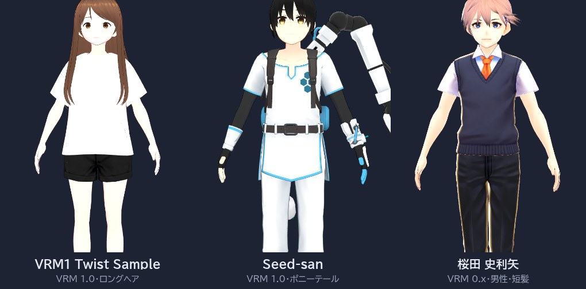
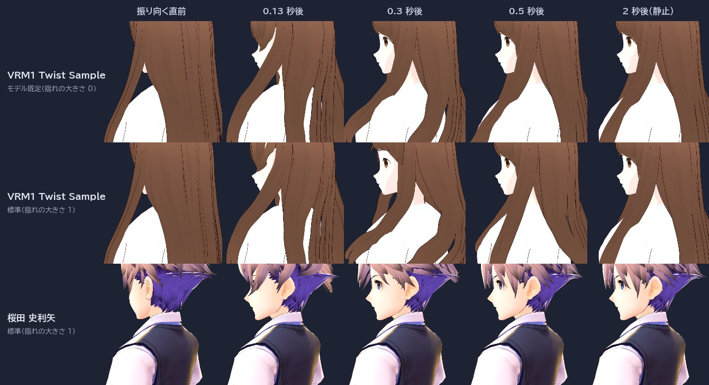
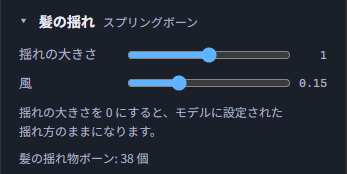

# Gemini VTuber Studio

ローカルカメラの映像から、VRM アバターをリアルタイムに動かす VTuber アプリです。
カメラ取得 → 座標化 → モーショントラッキング → 3D 描画はブラウザ内で毎フレーム処理します。
Gemini の各モデルは、演出・空間認識・外見の設計・画像生成・音声を役割ごとに分担します。

- 3D モデル: VRM コンソーシアムの汎用サンプル（VRoid 標準構造）を取り込み、その構造のまま Gemini で改変します。男性・短髪の VRoid サンプル（桜田 史利矢、VRM 0.x、CC0）も選べます
- 髪の揺れ: モデルが持つ揺れ物（VRM のスプリングボーン）を使い、頭の動きや風で髪を揺らします。VRM 0.x / 1.0 のどちらでも、モデルを替えても動きます
- トラッキング: MediaPipe（顔 478 点と 52 表情、姿勢 33 点、手 21 点×2）を GPU で処理し、CPU へ自動で切り替えます
- Gemini: Live、Flash-Lite、Robotics-ER、Pro、Nano Banana Pro/2、TTS の 8 ロールを、API キーで使えるモデルへ自動で割り当てます


左: 右手を顔に当てる動きに追従（VRM1 Twist Sample）。右: 首の傾きに追従（桜田 史利矢）。左下のカメラ映像は「カメラ映像をぼかす」でぼかしています。

設計の詳細は [docs/ARCHITECTURE.md](docs/ARCHITECTURE.md) を参照してください。

## 必要なもの

- Node.js 24 以上
- `GEMINI_API_KEY`（環境変数、または `.env` に記述）。未設定でもトラッキングと描画は動きます
- カメラが使えるブラウザ（Chrome / Edge）。WSL2 で動かす場合は、Windows 側のブラウザで `http://localhost:8790` を開きます

## 使い方

```bash
npm install
npm run setup      # MediaPipe モデル・WASM・サンプル VRM 3 体を取得（約 70 MB）
npm run dev        # http://localhost:8790
```

1. 「カメラ開始」を押します。顔・腕・手・指の動きがアバターに反映されます。初めて使うカメラでは「右手を上げてください」と表示されるので、右手を上げると映像の左右の向きを自動で判定して保存します
2. カメラ開始の約 1 秒後に、正面の向き・視線・無表情時の癖を自動で補正します。ずれる場合は画面を見て「正面キャリブレーション」を押します
3. 「3Dモデル」パネルでモデルを選ぶか、手持ちの `.vrm` を読み込みます（[モデルの読み込みと差し替え](#モデルの読み込みと差し替え)）
4. 「髪の揺れ」パネルで、揺れの大きさと風の強さを調整できます（[髪の揺れ](#髪の揺れ)）
5. 必要に応じて Gemini の機能を使います

| パネル | できること | 使うモデル（既定） |
| --- | --- | --- |
| アバター設計 | 文章（とカメラ映像）から、ペルソナ・髪や服の色・小物・背景を設計して適用します。テクスチャも描き換えます | gemini-3.1-pro-preview、gemini-3-pro-image、gemini-3.1-flash-image |
| Gemini Live 演出 | 声と映像を常時送ります。AI が表情・ジェスチャー・背景・テロップを演出し、共演者として声で応答します | gemini-3.1-flash-live-preview |
| 表情リアクター | 数秒ごとに映像から感情とジェスチャーを推定します（マイク不要で低コスト） | gemini-3.5-flash-lite |
| 空間認識・小道具 | 手に持った物を座標化して、アバターの手に小道具を付けます。構図から全身モードを自動で切り替えます | gemini-robotics-er-2-preview |
| 背景生成 | 説明文から配信背景を生成します | gemini-3.1-flash-image |
| アバターの声 | 台詞をペルソナの声で読み上げ、口パクさせます | gemini-3.8-flash-tts |

- 配信に使うときは、背景を「透過」か「クロマキー」にし、`H` キーで操作パネルを隠して画面をキャプチャします（左下のカメラ映像も隠れます）
- 操作パネルごと画面を撮影・配信するときは、「カメラ」パネルの「カメラ映像をぼかす（スクリーンショット・配信用）」をオンにすると、左下のカメラ映像だけがぼけます。トラッキングの線はそのまま見えるので、動きを見せながら顔は隠せます。設定はブラウザに保存されます
- モデルの割り当ては `config/models.json` で決まります。`VTUBER_MODEL_DESIGNER=gemini-2.5-pro` のように環境変数で上書きできます
- 割り当てたモデルの疎通確認は `npm run probe` で行えます（`--images` を付けると画像生成も試します）

## モデルの読み込みと差し替え




- **すぐ試せるサンプル 3 体**: `npm run setup` で、作りの違う 3 体（ロングヘアの女性、ポニーテールのロボット風、短髪の男性）を取得します。「3Dモデル」パネルの「モデル」で選ぶだけで切り替わります
- **自分のモデルに差し替え**: 「手持ちの .vrm を読み込む」を押すか、`.vrm` ファイルを画面にドラッグ＆ドロップします。VRM 0.x と 1.0 のどちらの形式も読み込めます（VRoid Studio で書き出したモデルで確認しています）。古い形式（0.x）のモデルも、腕・首・視線・小物の向きが 1.0 と同じように動きます
- **差し替えても設定はそのまま**: カメラは止まらず、正面キャリブレーション・構図・背景・髪の揺れの設定も引き継がれます。小物と手の小道具、アバター設計で変えた色は新しいモデルには付かないので、必要なら付け直します
- **利用条件の表示**: モデルに書かれた作者と利用条件をパネルに表示します。クレジット表記が必要なモデル（例: Seed-san）は、画面右下に自動で表示します

## 髪の揺れ



頭をすばやく 35° 振り向いたときの髪の動きです。上段はモデルに設定された揺れ方のまま、中段と下段は標準の設定です。



- **振り向くと髪が揺れ戻る**: 頭を動かすと髪が遅れてついてきて、止まった後に揺れ戻ってから落ち着きます。モデルに設定された揺れ方は控えめなことが多いので、標準ではもう少し揺れるようにしています（上の画像の上段と中段）
- **2 つのつまみで好みに合わせる**: 「揺れの大きさ」は 0（モデルの設定のまま）、1（標準）、2（大きく）です。「風」を上げると、じっとしていても髪がそよぎます
- **どのモデルでも同じくらい揺れる**: 髪の長さ、骨の長さ、モデルの大きさが違っても、揺れる角度がそろうように調整します。画面のリフレッシュレート（60 Hz、144 Hz など）が違っても揺れ方は変わりません
- **服や小物はそのまま**: 調整するのは髪だけです。スカートや袖などの揺れ物は、モデルの設定どおりに動きます
- **必要なもの**: モデルに揺れ物（スプリングボーン）が設定されていることです。VRoid Studio で作った髪など、多くの VRM には入っています。パネルに認識した髪のボーンの数が出て、揺れ物がないモデルでは「揺れ物（スプリングボーン）がありません」と表示します。髪のボーンは名前（`Hair`、`髪`、`もみあげ` など）で見分け、名前で見分けられないときは頭の下の揺れ物をすべて髪として扱います
- 設定はブラウザに保存され、モデルを差し替えても引き継がれます

## 動作確認済みの内容

- 単体テスト 89 件（`npm test`）: VRM 0.x の軸の変換、髪の揺れ（フレームレートに依らない挙動、揺れ戻し、風、折れ曲がりの上限、VRM 0.x の構造、大きさの違うモデル）、座標変換、ミラー、入力映像の左右反転、キャリブレーション、肘のヒンジ分解、肘が映らないときの IK、左右の手の識別（親指・小指アンカーと時間的連続性）、指の曲げ、あいうえおの判別、無表情ベースライン、回転スパイク除去、ヒステリシス、頭の平滑化、モデル割り当て、AI 出力の検証
- 実カメラ（USB Web カメラ、1280×720）での診断ログによる調整: 追跡 約 60 fps（GPU、1 フレーム 約 16 ms）
- 実カメラで、桜田 史利矢と Seed-san の髪の揺れを確認（頭をすばやく動かすと揺れ、止めると落ち着くこと）。このとき見つかった、数 mm の短い骨が裏返る問題は修正済み
- 型検査（`npm run typecheck`）と本番ビルド（`npm run build`、`npm start`）
- ヘッドレス Chromium の擬似カメラに人物画像を入力した E2E 確認:
  - 姿勢・両手・顔を検出（顔は頭部の切り出しで検出）し、ミラーで正しい側の腕が上がること
  - Robotics-ER がマグカップを検出し、アバターの正しい手に小道具が付くこと
  - Pro と Nano Banana によるペルソナ設計、テクスチャ 3 枚の描き換え、背景生成
  - Live API で音声応答、字幕、`set_expression`・`play_gesture`・`set_scene`・`show_caption` のツール呼び出し
  - リアクターの推定（約 1.3 秒）と TTS の口パク
  - 2 体目のサンプル（Seed-san）への切り替えとクレジット表示
  - 3 体目（桜田 史利矢、VRM 0.x）で、待機姿勢・頷き・腕上げ・首の傾き・視線・小物の向きが VRM 1.0 のモデルと一致すること、髪の揺れ（頭を振ったとき・風）

## 診断ログ（開発時）

`npm run dev` のときは、追跡の統計値（検出率、処理時間、回転速度、表情の値の範囲など）を 2 秒ごとに `logs/diag.jsonl` へ記録します。
画像や映像は送りません。パネルの「診断」で止められます。閾値や平滑化の調整に使います。

## 制約

- MediaPipe の表情の左右の扱いがモデルの版によって異なる可能性があります。ウインクが逆になる場合は「表情の左右を入れ替える」をオンにしてください
- 指（特に親指）の回転は近似です。腰の水平移動（体を左右に動かす）は未実装です
- 小道具は物体名から選んだ簡易形状です
- Live API と画像生成は利用料がかかります。Live は送信している間ずっと課金されます

## ライセンス

サンプル VRM の利用条件は [public/avatars/LICENSES.md](public/avatars/LICENSES.md) を参照してください。
Seed-san を使う場合は、クレジット表記「Seed-san model by VirtualCast, Inc.」が必要です（アプリが自動で表示します）。
